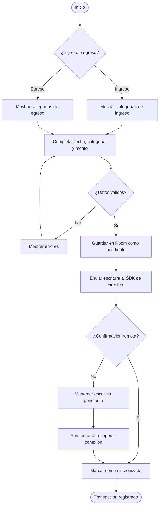
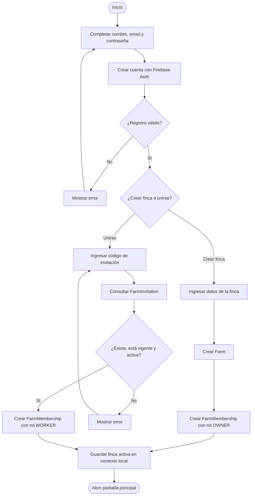
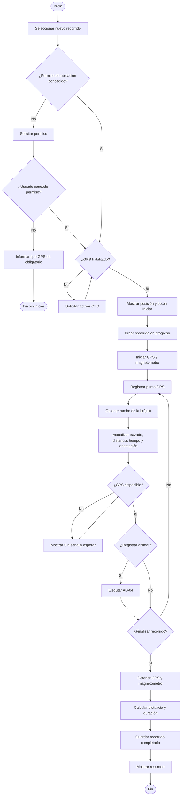
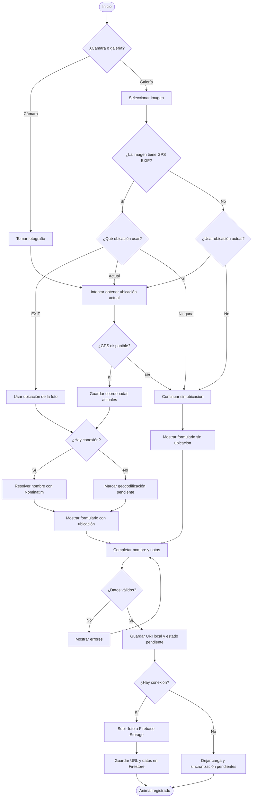
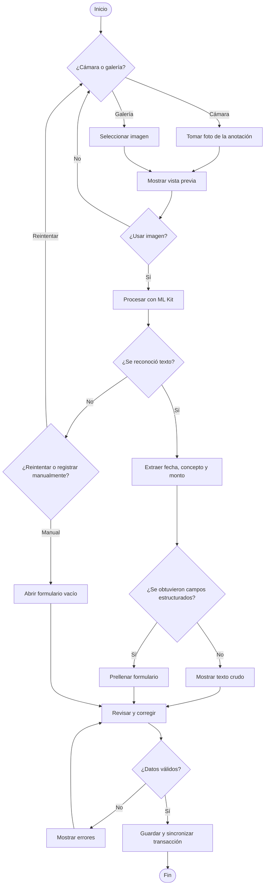
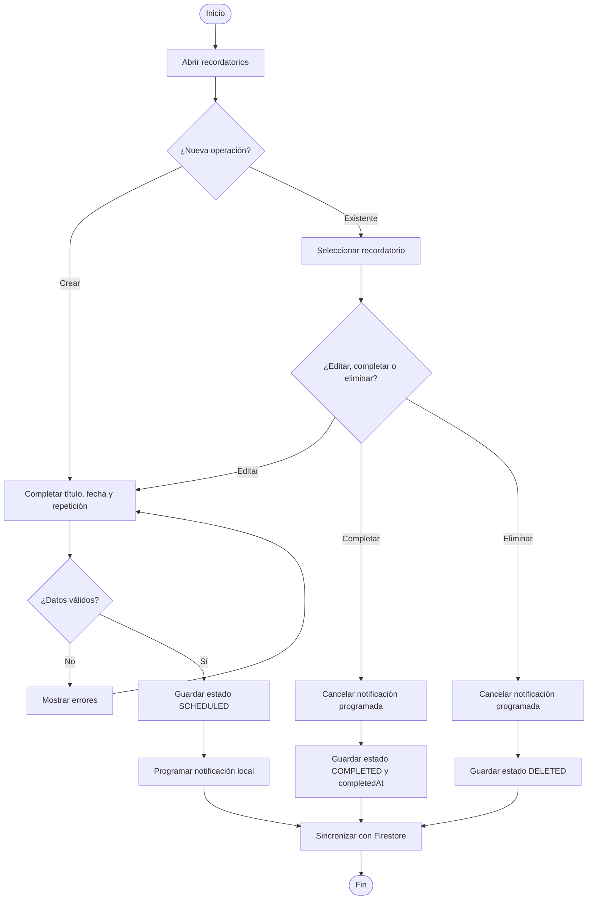
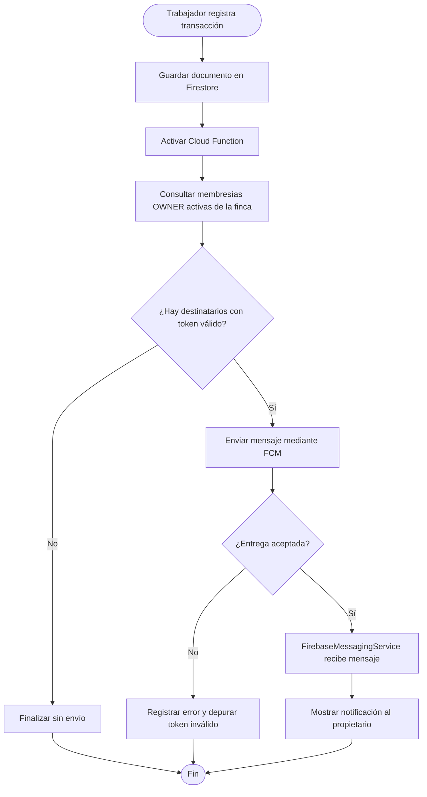

# Diagramas de Actividad
### Sistema de Gestión Económica — Finca Ganadera
*Versión 2 · 20 de agosto de 2026*

---

> Los diagramas muestran decisiones y caminos alternativos de los procesos de
> negocio. Usan `flowchart` de Mermaid como notación equivalente a actividades.

## AD-01 — Registrar ingreso o egreso

Cubre UC-01 y UC-02.

Resume las decisiones que se toman al registrar un movimiento financiero. El
usuario selecciona el tipo, completa los datos y corrige los campos inválidos
antes de iniciar el guardado local y la sincronización.

> **Nota:** si no hay conexión, la operación no se pierde; permanece pendiente
> y se reintenta cuando el dispositivo recupera la red.

---

## AD-02 — Registrarse y asociarse a una finca

Cubre UC-13 y parte de UC-14.

Muestra el proceso de creación de una cuenta y la asociación del usuario con
una finca. El flujo cambia según el usuario cree una finca o ingrese un código
para unirse a una existente.

> **Nota:** una invitación solo permite crear la membresía cuando existe, sigue
> vigente y se encuentra activa.

---

## AD-03 — Realizar recorrido de inspección

Cubre UC-15, UC-16 y UC-17.

Describe las actividades necesarias para comenzar, mantener y finalizar una
inspección. Durante el recorrido se registran puntos GPS y el rumbo del
dispositivo, y opcionalmente se pueden registrar animales.

> **Nota:** la falta de permiso impide iniciar el recorrido. Una pérdida
> temporal de señal durante un recorrido activo muestra una advertencia y el
> seguimiento continúa cuando la señal regresa.

---

## AD-04 — Registrar animal con foto y ubicación opcional

Cubre UC-20 y aporta datos a UC-21.

Representa las alternativas para obtener una fotografía y asociarle una
ubicación. Después de validar el formulario, la imagen se conserva localmente y
se sincroniza junto con los datos del animal.

> **Nota:** las imágenes de galería pueden usar coordenadas EXIF, la ubicación
> actual o ninguna. Nominatim solo se consulta cuando existen coordenadas y hay
> conexión.

---

## AD-05 — Registrar transacción mediante OCR

Cubre UC-09, UC-10 y UC-11.

Muestra el proceso de reconocimiento de una anotación fotografiada. El sistema
intenta extraer campos estructurados, pero mantiene caminos alternativos para
repetir la captura o completar manualmente el formulario.

> **Nota:** el OCR ayuda a diligenciar los datos; la confirmación final siempre
> corresponde al usuario.

---

## AD-06 — Crear, editar, completar o eliminar recordatorio

Cubre el flujo principal de UC-19.

Reúne las operaciones sobre recordatorios: crear, editar, completar y eliminar.
La programación local se crea o cancela de acuerdo con el estado guardado por
el usuario.

> **Nota:** completar y eliminar cancelan la notificación futura antes de
> sincronizar el nuevo estado con Firestore.

---

## AD-07 — Enviar notificación push al propietario

Cubre el flujo alternativo de UC-19 cuando un trabajador registra una
transacción.

Muestra las actividades del envío automático de una notificación al
propietario. Cloud Functions identifica los destinatarios de la finca y FCM
entrega el mensaje a sus dispositivos.

> **Nota:** si no existen tokens válidos, el flujo termina sin envío. Los tokens
> rechazados pueden depurarse para evitar intentos posteriores innecesarios.

