# Diagramas de Secuencia
### Sistema de Gestión Económica — Finca Ganadera
*Versión 4 · 20 de agosto de 2026*

---

> Diagramas alineados con MVVM + Clean Architecture ligera, Room, Firebase y
> los casos de uso vigentes. Cada sección explica el propósito del flujo y las
> responsabilidades principales de sus participantes.

## SD-01 — Registrar transacción y sincronizar

Cubre UC-01 y UC-02 (RF-01, RF-02, RNF-07).

Representa el registro de un ingreso o egreso desde la carga de categorías
hasta su almacenamiento y sincronización. La transacción se guarda primero en
Room para que la operación funcione sin conexión; el repositorio usa el SDK de
Firestore para enviarla cuando la red está disponible.

> **Nota:** el estado `PENDING` indica que el dato ya existe localmente, pero la
> confirmación remota todavía no se ha recibido. Al llegar el snapshot de
> Firestore, el registro cambia a `SYNCED`.

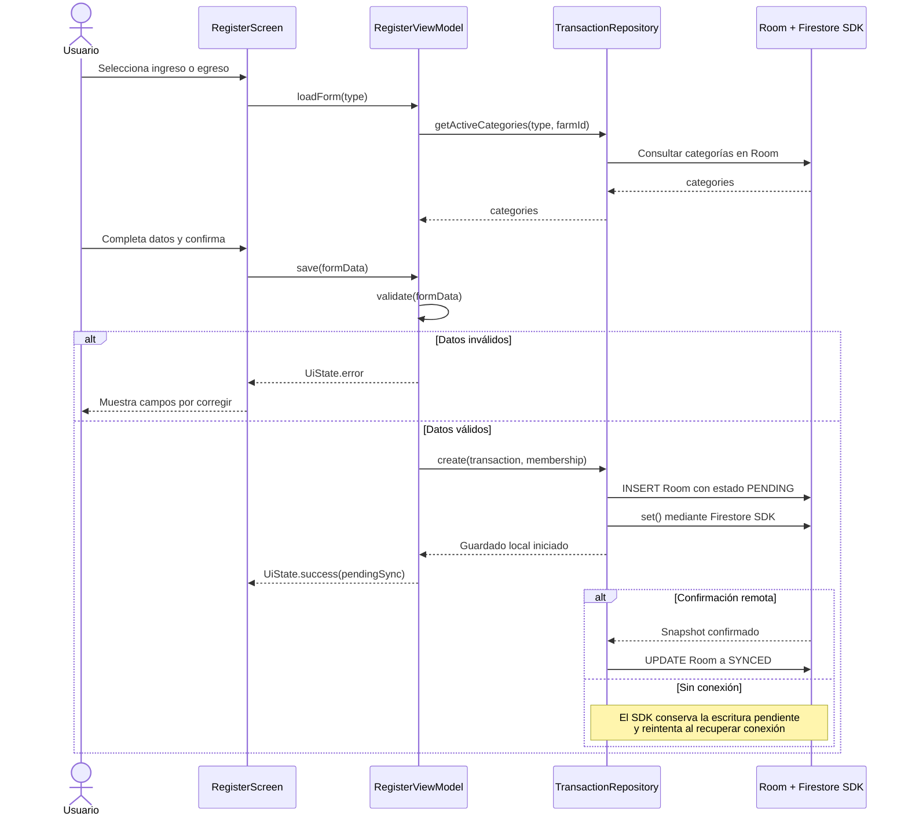

---

## SD-02 — Consultar balance y comparar periodos

Cubre UC-03 (RF-03).

Muestra cómo el propietario consulta el balance de la finca, compara dos
periodos o solicita un desglose por actividad. El `CalculateBalanceUseCase`
concentra los cálculos para mantenerlos separados de la interfaz.

> **Nota:** el repositorio consulta la proyección local de Room, lo que permite
> mostrar resultados incluso cuando el dispositivo no tiene conexión.

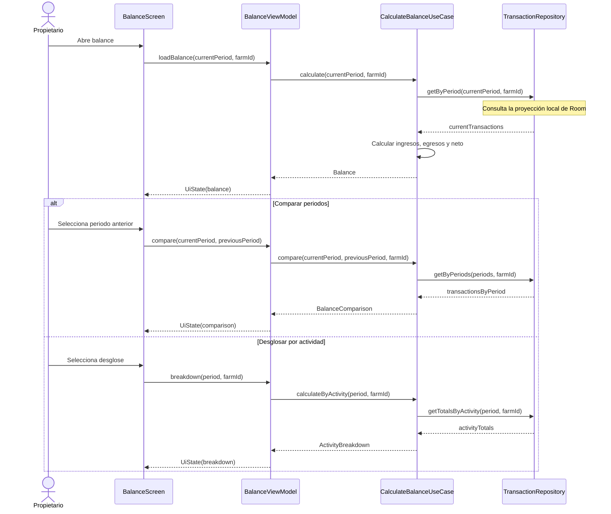

---

## SD-03 — Editar o eliminar una transacción

Cubre UC-05 y UC-06 (RF-05, RF-06).

Describe las dos operaciones disponibles desde el historial: editar una
transacción o eliminarla después de confirmar la acción. En ambos casos, el
repositorio actualiza primero la información local y coordina el cambio remoto.

> **Nota:** la eliminación requiere confirmación para evitar pérdidas por una
> selección accidental. La lista se actualiza después de reconciliar los datos.

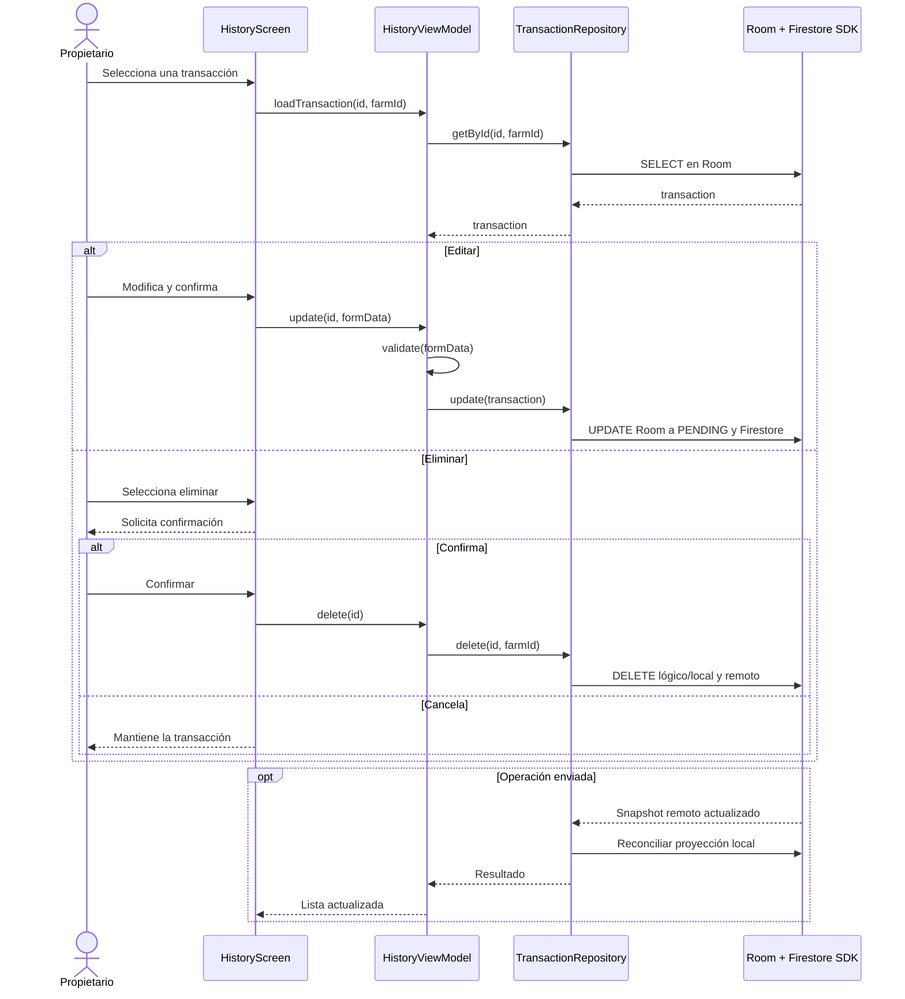

---

## SD-04 — Registrarse y crear o unirse a una finca

Cubre UC-13 y parte de UC-14 (RF-13, RF-14).

Representa el registro de una cuenta y las dos formas de obtener acceso a una
finca: crear una nueva como propietario o unirse como trabajador mediante un
código de invitación.

> **Nota:** `FarmMembership` relaciona al usuario con una finca y almacena el
> rol que tiene dentro de ella. La invitación se valida por existencia,
> vigencia y estado antes de crear la membresía.

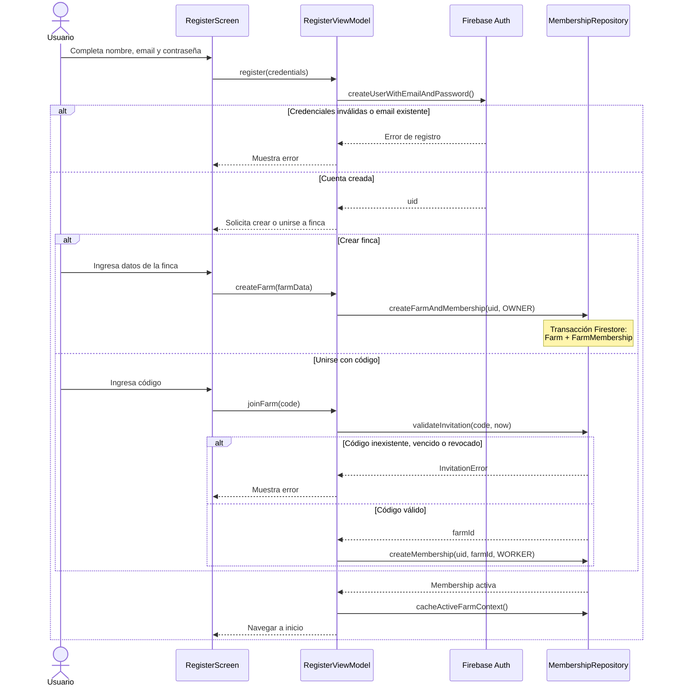

---

## SD-05 — Recorrido de inspección con GPS y brújula

Cubre UC-15, UC-16 y UC-17 (RF-15, RF-16, RF-17).

Muestra el ciclo completo de una inspección: validación del GPS, creación del
recorrido, captura periódica de puntos, visualización de la orientación y cierre
con el cálculo de distancia y duración.

> **Nota:** el GPS proporciona la posición y el magnetómetro proporciona el
> rumbo de la brújula. Si la señal GPS se pierde, la aplicación informa al
> usuario y continúa cuando vuelve a estar disponible.

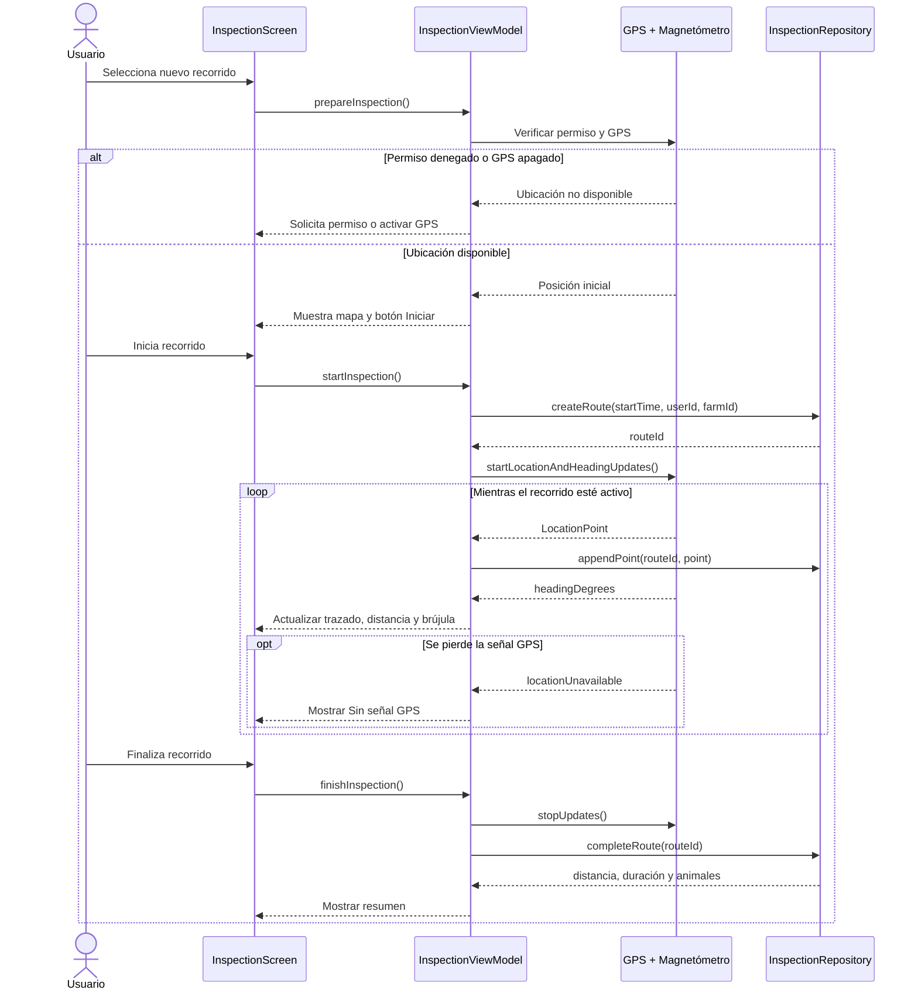

---

## SD-06 — Registrar animal con foto y ubicación opcional

Cubre UC-20 y alimenta UC-21 (RF-20, RF-21).

El flujo se divide en dos partes para distinguir la interacción con el
dispositivo de la persistencia. Primero se obtiene la fotografía y se elige la
ubicación; después se guarda el registro y se sincronizan la imagen y sus datos.

### SD-06A — Capturar imagen y elegir ubicación

Describe la captura mediante CameraX o la selección desde la galería. En una
foto existente se puede usar la ubicación EXIF, la posición actual o continuar
sin coordenadas.

> **Nota:** la ubicación es opcional para que la falta de GPS o de metadatos no
> impida registrar al animal.

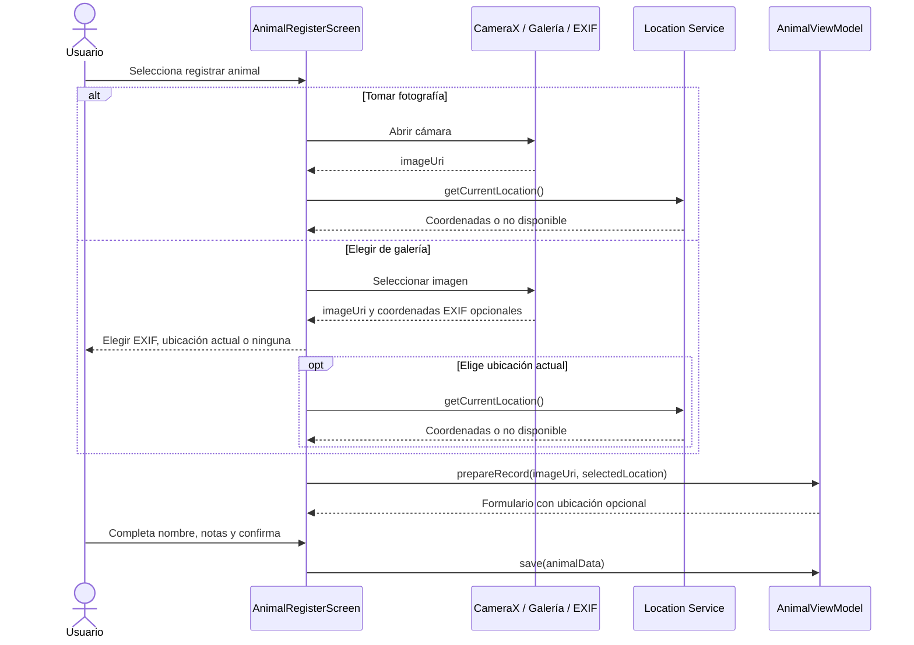

### SD-06B — Geocodificar, guardar y sincronizar

Describe cómo Nominatim convierte las coordenadas en un nombre de lugar y cómo
el repositorio conserva la foto localmente antes de subirla a Firebase Storage.
La URL obtenida se almacena junto con los datos del animal en Firestore.

> **Nota:** cuando no hay conexión, el registro conserva el estado `PENDING` y
> la carga de la fotografía y la geocodificación pueden ejecutarse más tarde.

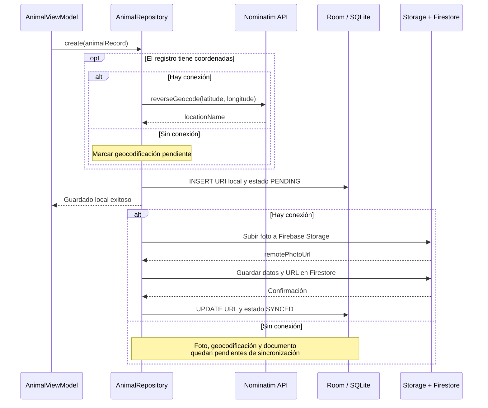

---

## SD-07 — Captura de anotación y OCR on-device

Cubre UC-09, UC-10 y UC-11 (RF-09, RF-10, RF-11).

Representa el registro de una transacción a partir de una fotografía. ML Kit
reconoce el texto en el dispositivo y el parser intenta convertirlo en fecha,
concepto, monto y categoría para prellenar el formulario.

> **Nota:** el usuario siempre revisa y confirma la información. Si el OCR no
> reconoce el texto, puede tomar otra foto o continuar con el registro manual.

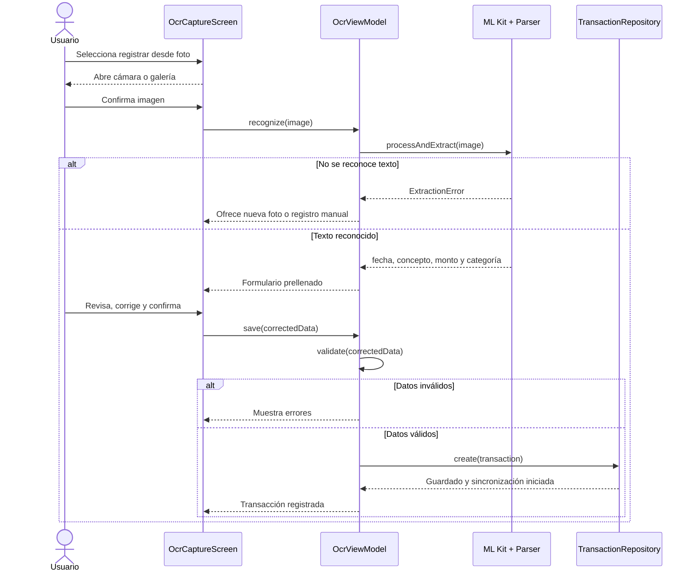

---

## SD-08 — Crear recordatorio y programar notificación local

Cubre el flujo principal de UC-19 (RF-19).

Muestra la creación o edición de un recordatorio y su programación en Android.
También incluye la cancelación de la alarma cuando el recordatorio se completa
o se elimina.

> **Nota:** el recordatorio se sincroniza como dato de la finca, pero la alarma
> que aparece en una fecha y hora determinadas se programa localmente en el
> dispositivo.

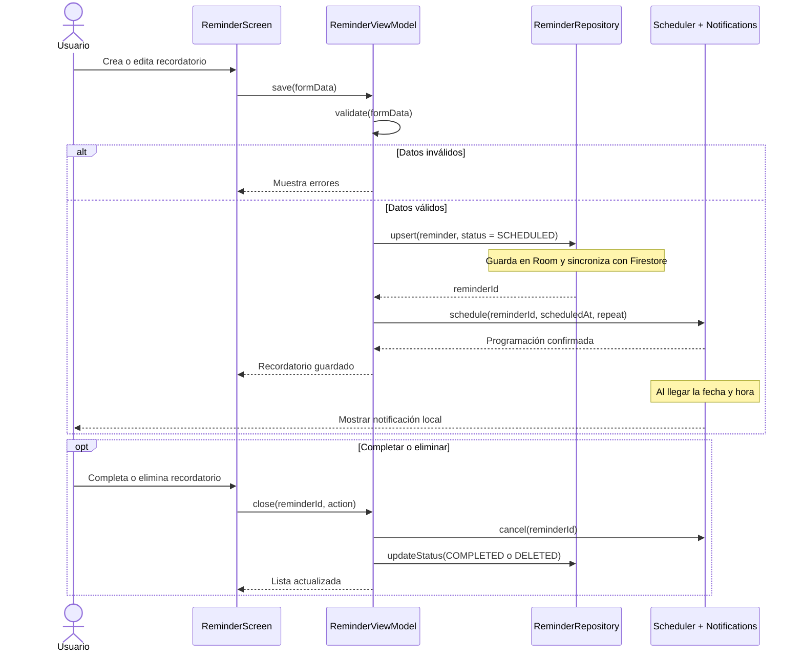

---

## SD-09 — Notificar al propietario por una transacción del trabajador

Cubre el flujo push alternativo de UC-19.

Describe la notificación enviada al propietario cuando un trabajador registra
una transacción. La creación del documento activa una Cloud Function, que busca
los propietarios autorizados y envía el mensaje por Firebase Cloud Messaging.

> **Nota:** `FirebaseMessagingService` recibe el mensaje en el dispositivo del
> propietario y genera la notificación visible de Android.

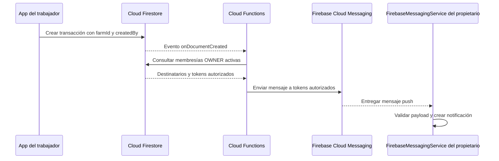

---

## SD-10 — Exportar reporte

Cubre UC-08 (RF-08).

Representa la generación de un reporte a partir de los filtros activos del
balance o del historial. El caso de uso consulta las transacciones, genera el
archivo solicitado y entrega una URI que Android puede compartir.

> **Nota:** si la consulta no devuelve datos, el sistema informa la situación y
> no crea un archivo vacío.

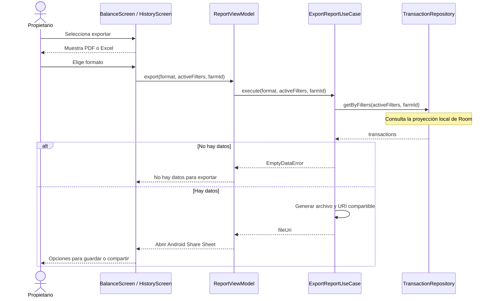
