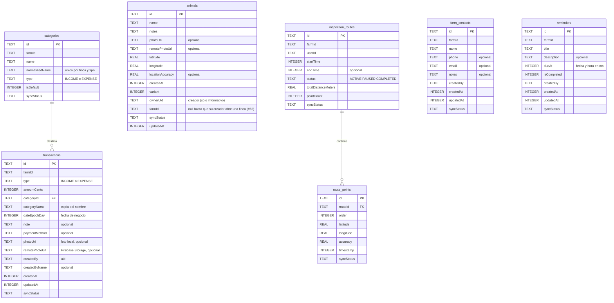
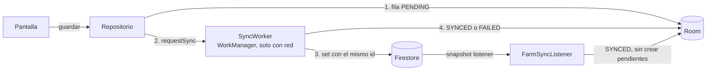

# Paso 6 — Modelo de datos

Modelo de datos de la app (issue #23): tablas locales en Room y estructura remota en Cloud
Firestore. La estrategia de sincronización está en [ADR-002](../4-arquitectura/adrs/adr-002-local-database.md)
y [ADR-003](../4-arquitectura/adrs/adr-003-backend-sync.md).

## Principios

| Regla | Por qué |
|---|---|
| La UI lee **solo de Room** (`Flow<List<T>>`) | Funciona sin red y las consultas con filtros/sumas son SQL |
| Las escrituras van a Room y luego a Firestore (write-through) | La UI ve el cambio al instante; Firestore lo encola si no hay red |
| Los IDs son **UUID generados en el celular** | La fila de Room y el documento de Firestore comparten id desde el primer momento, sin esperar al servidor |
| Montos en **centavos enteros** (`amountCents: Long`) | `Double` acumula errores de redondeo en sumas de dinero |
| La **fecha de negocio** (`dateEpochDay`) va aparte de `createdAt`/`updatedAt` | El usuario puede registrar hoy un gasto de ayer; reportes y filtros usan la fecha de negocio |
| Cada tabla tiene **`syncStatus`** (`PENDING`/`SYNCED`/`FAILED`) | Saber qué filas falta subir a Firestore y cuáles rechazó (ver "Sincronización offline") |
| La validación ocurre en el repositorio **antes** de escribir | A Firestore solo llega data limpia |

### Fechas de negocio

`dateEpochDay` = días desde 1970-01-01 (`BusinessDate.of(2026, 11, 21)` = 20778). Se usa `Long` y
no `java.time.LocalDate` porque `minSdk` es 24 y el proyecto no tiene desugaring (`LocalDate`
requiere API 26). Utilidades en `domain/model/BusinessDate.kt`.

## Room (`AppDatabase`, versión 6)



Solo `route_points → inspection_routes` tiene llave foránea real (borrado en cascada). La relación
`transactions → categories` es lógica: la transacción guarda `categoryName` para que el historial
se siga leyendo si la categoría se renombra o se borra.

### Índices

| Tabla | Índice |
|---|---|
| `transactions` | `(farmId, dateEpochDay)`, `(farmId, categoryId)` |
| `categories` | `(farmId, type, normalizedName)` **único** |
| `animals` | `ownerUid`, `farmId` |
| `inspection_routes` | `farmId` |
| `route_points` | `routeId` |
| `farm_contacts` | `farmId` |
| `reminders` | `(farmId, dueAt)` |

### Migraciones

Todas en `data/local/AppDatabase.kt` (lista `ALL_MIGRATIONS`). **Nunca** usar
`fallbackToDestructiveMigration`: borraría los datos de los celulares de prueba.

| Versión | Cambio |
|---|---|
| 1 → 2 | Tabla `animals` |
| 2 → 3 | `animals.variant` |
| 3 → 4 | `animals.ownerUid` |
| 4 → 5 | Tabla `categories` |
| 5 → 6 | Tablas `transactions`, `farm_contacts`, `reminders`; `syncStatus` en las tablas existentes; `animals.farmId` y `animals.remotePhotoUrl` |
| 6 → 7 | Tabla `pending_deletes` (borrados por enviar a Firestore) |
| 7 → 8 | `animals.updatedAt` (los animales se sincronizan con la finca, #62) |

`MigrationInstrumentedTest` crea una base v5 a mano y verifica que la migración conserve los datos y
que Room acepte el esquema resultante.

## Firestore

```
users/{uid}                                   name, email, farmId, role, createdAt
farms/{farmId}                                name, ownerUid, inviteCode, createdAt
farms/{farmId}/members/{uid}                  role (OWNER | WORKER), name, email, joinedAt
farms/{farmId}/transactions/{id}
farms/{farmId}/categories/{id}
farms/{farmId}/animalRecords/{id}
farms/{farmId}/contacts/{id}
farms/{farmId}/reminders/{id}
farms/{farmId}/inspectionRoutes/{id}
farms/{farmId}/inspectionRoutes/{id}/points/{pointId}
```

- Todo lo de la finca cuelga de `farms/{farmId}`: así las Security Rules (issue #28) se escriben
  una sola vez ("es miembro de esta finca").
- Los documentos tienen los mismos campos que la tabla de Room **excepto** `syncStatus` (dato local)
  y `farmId` (ya está en la ruta). La foto local (`photoUri`) tampoco se sube; se sube
  `remotePhotoUrl`.
- Rutas en `data/remote/FirestorePaths.kt`; conversión en `data/remote/FirestoreMappers.kt`.

## Repositorios

Interfaces en `domain/repository`, implementaciones en `data/repository`, enlazadas en
`data/injection/RepositoryModule.kt`.

| Interfaz | Implementación | Notas |
|---|---|---|
| `TransactionRepository` | `TransactionRepositoryImpl` | Valida monto > 0 y que la categoría exista y sea del mismo tipo |
| `CategoryRepository` | `CategoryRepositoryImpl` | Nombres únicos por finca y tipo; `insertDefaults` no duplica |
| `ContactRepository` | `ContactRepositoryImpl` | |
| `ReminderRepository` | `ReminderRepositoryImpl` | Solo datos; las notificaciones son el issue #31 |
| `FarmRepository` | `FarmRepositoryImpl` | `createFarm` se llama al registrarse con "Crear finca" |
| `UserRepository` | `UserRepositoryImpl` | `observeCurrentFarmId()` da el `farmId` para los demás repositorios |
| `AnimalRepository` | `RoomAnimalRepository` | Animales de la finca activa (#62), sincronizados con `animalRecords`; los registrados antes de #62 pasan a la finca de su creador |
| `InspectionRepository` | `RoomInspectionRepository` | Sin cambios de comportamiento |

### Cómo usarlos desde un ViewModel

```kotlin
@HiltViewModel
class TransactionHistoryViewModel @Inject constructor(
    userRepository: UserRepository,
    private val transactionRepository: TransactionRepository,
) : ViewModel() {

    val transactions: StateFlow<List<Transaction>> = userRepository.observeCurrentFarmId()
        .flatMapLatest { farmId ->
            if (farmId == null) flowOf(emptyList())
            else transactionRepository.observeTransactions(farmId)
        }
        .stateIn(viewModelScope, SharingStarted.WhileSubscribed(5_000), emptyList())
}
```

## Roles y permisos (issue #28)

- **Fuente de verdad del rol:** `farms/{farmId}/members/{uid}.role` (`OWNER` | `WORKER`). El campo
  `users/{uid}.role` es solo informativo.
- **Tabla de permisos:** `domain/model/Permission.kt`. Es la única: la usan las pantallas para
  ocultar opciones y los repositorios para rechazar escrituras (`SecurityException`).
- **Sesión:** `SessionRepository.session` (`StateFlow<Session>`) combina usuario + perfil +
  membresía con listeners, así que el rol se actualiza en vivo. En la UI se lee con
  `SessionViewModel` (`session`, `currentUserRole`, `can(permission)`).
- **Rutas protegidas:** `PermissionGate` en `AppNavigation` para Categorías, Trabajadores y
  Editar transacción.
- **Security Rules:** `firebase/firestore.rules` (ver `firebase/README.md`).

| Permiso | Propietario | Trabajador |
|---|---|---|
| Registrar transacción, ver historial y reportes | ✅ | ✅ |
| Registrar animales, iniciar inspecciones, contactos, recordatorios | ✅ | ✅ |
| Editar / eliminar transacciones | ✅ | ❌ |
| Gestionar categorías y trabajadores | ✅ | ❌ |
| Ver / regenerar código de invitación, configurar la finca | ✅ | ❌ |

### Cómo usarlo en una pantalla

```kotlin
// En el composable de la pantalla
val sessionViewModel: SessionViewModel = hiltViewModel()
val session by sessionViewModel.session.collectAsStateWithLifecycle()

if (session.can(Permission.DELETE_TRANSACTION)) {
    IconButton(onClick = { viewModel.onToggleDeleteDialog(true) }) { /* ... */ }
}
```

En el ViewModel, las llamadas a los repositorios ya verifican el permiso; basta capturar el error:

```kotlin
try {
    transactionRepository.delete(farmId, id)
} catch (e: SecurityException) {
    _uiState.update { it.copy(error = e.message) }
}
```

## Sincronización offline (issue #32)

Código en `data/sync/`. Sincroniza **transacciones, categorías, contactos y recordatorios**.



**Subida (Room → Firestore)**
- Los repositorios guardan en Room como `PENDING` y llaman a `SyncScheduler.requestSync()`.
- `SyncWorker` (WorkManager) corre **solo con red**, sobrevive al cierre de la app y al reinicio del
  celular, y sube cada fila con `set` sobre el **mismo id**: repetir una subida no crea duplicados.
- Al confirmar, la fila pasa a `SYNCED` (solo si no cambió mientras se subía: mismo `updatedAt`).
- Error de red o tiempo de espera → sigue `PENDING` y WorkManager reintenta con espera exponencial
  (30 s, 1 min, 2 min…). Además hay un trabajo periódico cada 30 min como respaldo.
- Rechazo definitivo (Security Rules, datos inválidos) → `FAILED`. **No se reintenta solo**; vuelve
  a la cola si el usuario la edita o pulsa **Reintentar** en el inicio.
- Borrados: la fila se quita de Room y queda anotada en `pending_deletes` hasta que Firestore la borra.

**Bajada (Firestore → Room)**
- `FarmSyncListener` escucha las colecciones de la finca activa (se reinicia al cambiar de finca o
  cerrar sesión) y guarda lo que llega como `SYNCED`, **sin generar operaciones pendientes**.
- Conflictos: **last-write-wins** por `updatedAt` (`SyncConflicts`). Si la fila local tiene cambios
  sin subir y es igual o más nueva, se conserva. Cada conflicto se registra en Logcat (etiqueta
  `SgeSync`).
- Lo borrado aquí y aún no enviado no "revive". Lo borrado en otro celular con la app cerrada se
  detecta con la primera respuesta completa del servidor.
- La foto local de una transacción (`photoUri`) se conserva al aplicar cambios remotos.

**Indicadores en la UI**
- Historial e inicio: reloj junto a las transacciones `PENDING`, alerta en las `FAILED`.
- Inicio: "X registros pendientes de sincronización" y, si hay rechazos, botón **Reintentar**.
  Nada si todo está sincronizado.

**Cómo probar** (Logcat, filtro `SgeSync`)
1. Modo avión → registrar una transacción → aparece el reloj y el aviso en el inicio.
2. Quitar el modo avión → en segundos desaparece el reloj y el documento aparece en Firestore.
3. Con dos celulares de la misma finca: lo que se crea en uno aparece en el otro.
4. Cerrar la app a la fuerza con pendientes, volver a abrirla con red → se suben.
5. Crear 5 transacciones sin red, conectar → las 5 en Firestore, sin duplicados.

## Pendiente en otros issues

- **#29**: unirse a una finca con código de invitación (crear `members/{uid}` como WORKER).
- Animales e inspecciones todavía no se suben a Firestore ni se filtran por finca (necesitan además
  subir la foto a Firebase Storage). Para sumarlos basta un `SyncAdapter` nuevo en `data/sync/`.
